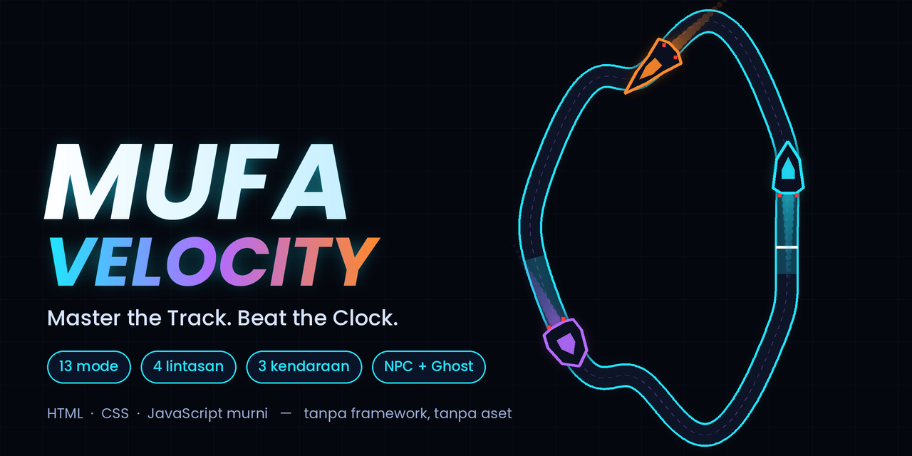
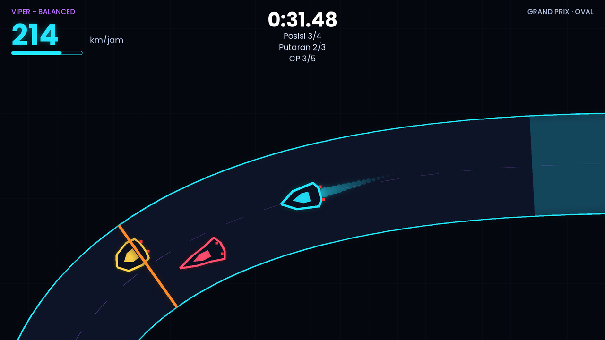
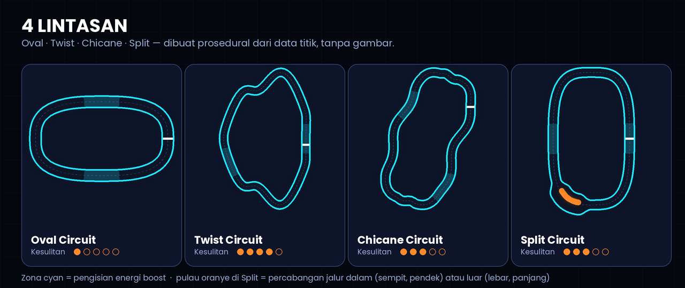
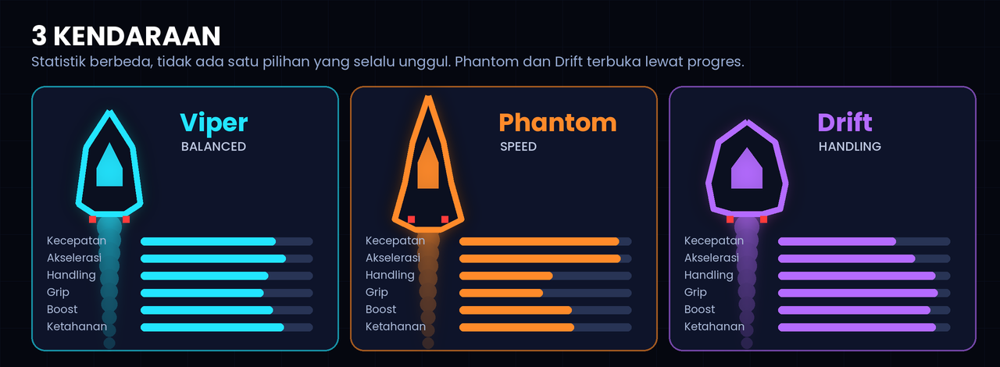
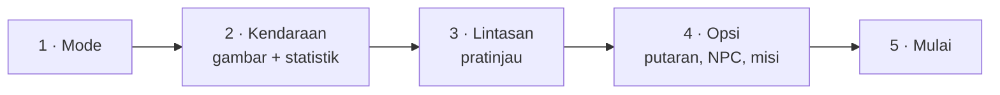

<div align="center">



# 🏎️ Mufa Velocity

### Master the Track. Beat the Clock.

Game balap arcade top-down bergaya neon futuristik.
**13 mode · 4 lintasan · 3 kendaraan · NPC · Ghost · Achievement** — semuanya dari HTML, CSS, dan JavaScript murni.

[](https://faris-it.github.io/velocity-game/)
[](https://github.com/Faris-IT/velocity-game/actions/workflows/tests.yml)
[](LICENSE)


**[▶ Main di browser](https://faris-it.github.io/velocity-game/)** &nbsp;·&nbsp; **[📦 Rilis](https://github.com/Faris-IT/velocity-game/releases)** &nbsp;·&nbsp; **[🐞 Lapor bug](https://github.com/Faris-IT/velocity-game/issues)**

</div>

---

## ✨ Kenapa menarik

- **Bukan sekadar siapa tercepat.** Ada mode presisi, bertahan hidup, mengumpulkan energi, drift berkombo, melawan ghost, hingga kejuaraan melawan NPC.
- **Semua dibuat lewat kode.** Lintasan, kendaraan, efek cahaya, rintangan, bahkan suara mesin dan efek audio dihasilkan secara prosedural. Tidak ada gambar, sprite, atau berkas audio.
- **Nyaman di desktop dan HP.** Keyboard penuh, tombol sentuh yang bisa diatur ukurannya, dan layout menu yang menyesuaikan layar.
- **Tanpa instalasi.** Cukup buka `index.html`. Tanpa framework, tanpa build, tanpa backend, dan jalan di hosting statis.
- **Teruji.** 168 pemeriksaan otomatis mencakup lintasan, fisika, AI, NPC, setiap mode, data tersimpan yang rusak, achievement, dan semua layar menu.

## 🖼️ Cuplikan

<p align="center">
  
</p>
<p align="center">
  
</p>
<p align="center">
  
</p>

> Gambar di atas adalah render ilustrasi yang digambar dari data lintasan dan kendaraan game yang sebenarnya.

## 🎮 13 Mode

| # | Mode | Tujuan singkat |
|---|------|----------------|
| 1 | **Grand Prix** | Selesaikan 3–5 putaran secepat mungkin, bisa melawan 3 atau 5 NPC |
| 2 | **Time Attack** | Kumpulkan skor dari putaran valid dalam 90 detik |
| 3 | **Perfect Lap** | 3 putaran bersih dengan jalur ideal; penalti > 500 = gagal |
| 4 | **Energy Collector** | Ambil 25 sel energi (jalur utama, berisiko, dan berkedip) lalu finis |
| 5 | **Boost Rush** | Atur energi boost dan zona pengisian; boros di tikungan itu berisiko |
| 6 | **Hazard Run** | Lewati rintangan bergerak; checkpoint memulihkan kondisi kendaraan |
| 7 | **Drift Master** | Raih 2.000 poin drift dengan kombo hingga x5 |
| 8 | **Ghost Rival** | Kalahkan rekaman ghost dari percobaan terbaikmu |
| 9 | **Survival Circuit** | Bertahan 180 detik saat rintangan makin banyak |
| 10 | **Checkpoint Blitz** | 12 gerbang berurutan; pilih rute aman atau rute pendek (+3 dtk) |
| 11 | **Risk & Reward** | 1.500 kredit sebelum 2 putaran; jalur dalam bernilai tinggi tapi sulit |
| 12 | **Velocity Trials** | 10 misi dengan aturan, skor, dan medali masing-masing |
| 13 | **Rival Cup** | 4 balapan di 4 lintasan melawan 5 NPC, poin kejuaraan |

## 🛣️ 4 Lintasan

| Lintasan | Karakter |
|----------|----------|
| **Oval** | Sederhana, cocok untuk belajar mengendalikan kendaraan |
| **Twist** | Tikungan berganti arah, lebih panjang |
| **Chicane** | Jalur kiri-kanan bergantian yang menguji presisi |
| **Split** | Percabangan di tikungan: jalur dalam sempit tapi pendek, jalur luar lebar tapi panjang |

## 🏎️ 3 Kendaraan

| Kendaraan | Gaya | Catatan |
|-----------|------|---------|
| **Viper** | Seimbang | Kendaraan awal, cocok untuk semua mode |
| **Phantom** | Kecepatan | Puncak tertinggi tapi melebar di tikungan dan lebih rapuh. Terbuka setelah 5 balapan |
| **Drift** | Handling | Lincah, boost terbesar, kecepatan puncak lebih rendah. Terbuka setelah 3 medali |

Tidak ada kendaraan yang unggul di semua mode. Ketahanan memengaruhi seberapa besar kerusakan di Hazard Run dan Survival Circuit.

## 🧭 Alur menu



Langkah yang tidak relevan dilewati otomatis (misalnya Rival Cup memakai 4 lintasan tetap). Dari menu utama juga ada **Garage**, **Tutorial & Uji Coba**, **Achievement**, **Rekor**, dan **Pengaturan**.

## ⌨️ Kontrol

| Aksi | Keyboard | Layar sentuh |
|------|----------|--------------|
| Gas | `W` / `↑` | Tombol **GAS** |
| Rem / mundur | `S` / `↓` | Tombol **REM** |
| Belok | `A` `D` / `←` `→` | Tombol ◀ ▶ |
| Boost | `Space` | Tombol **BOOST** |
| Jeda | `P` / `Esc` | Tombol **II** |
| Ulangi balapan | `R` | Menu jeda |

## 🏆 Achievement

First Finish · Speed Demon · Perfect Driver · Boost Master · Energy Hoarder · Drift Legend · Ghost Breaker · Untouchable · Checkpoint Champion · **Velocity Legend** (menangkan ke-12 mode dan raih minimal 7 dari 9 achievement lain).

## 🚀 Menjalankan

**Cara tercepat:** unduh repo lalu buka `index.html` di browser.

**Dengan server lokal** (opsional):

```bash
python3 -m http.server 8080
# buka http://localhost:8080
```

**Pengujian otomatis** (butuh Node.js, tanpa dependensi lain):

```bash
node tests/run-tests.js
```

**Deploy:** repo ini siap untuk GitHub Pages. Workflow `.github/workflows/pages.yml` menerbitkan berkas game setiap kali ada push ke `main`. Langkah lengkap ada di [`docs/GITHUB_SETUP.md`](docs/GITHUB_SETUP.md).

## 🧱 Struktur proyek

```text
velocity-game/
├── index.html
├── css/        style · hud · menu · mobile · themes
├── js/         config · input · track · physics · collision · vehicle · boost · drift
│               checkpoints · scoring · game-state · gates · tokens · obstacles
│               ai · npc · ghost · demo · renderer · art · audio · settings
│               storage · achievements · ui · main
├── modes/      satu berkas per mode (13 mode + tutorial + uji coba kendaraan)
├── data/       modes · vehicles · tracks · trials · achievements
├── tests/      run-tests.js
├── assets/     social-preview.png (gambar pratinjau repo, tidak dipakai game)
└── docs/       GITHUB_SETUP.md · screenshots/
```

Prinsip utamanya: input, fisika, rendering, dan aturan mode dipisahkan. Setiap mode memakai sistem inti yang sama lalu menambahkan aturannya sendiri lewat `MV.MODES`.

## 🔧 Catatan teknis

- **Fisika langkah tetap 120 Hz** dengan akumulator, sehingga terasa sama di FPS berbeda. Timer dan fisika berhenti saat jeda atau saat tab tidak aktif.
- **Lintasan dari data**: kurva dasar → titik berjarak sama → lebar variabel, kelengkungan, pulau percabangan, dan zona pengisian dihitung otomatis. Pengujian memeriksa jarak antar-bagian lintasan, radius tikungan minimum, dan arah start.
- **AI** memilih kecepatan dari kelengkungan lintasan di depan dan jarak pengereman, berbeda untuk tiap kendaraan.
- **Ghost** merekam posisi 20 kali per detik dan disimpan per kendaraan serta per lintasan.
- **Audio** memakai Web Audio API: suara mesin mengikuti kecepatan, efek dibuat dari osilator dan noise.
- **localStorage** divalidasi saat dimuat; data kosong atau rusak tidak membuat game gagal dibuka.

## 🗺️ Ide pengembangan

- Lintasan acak prosedural
- Kendaraan tambahan dan sistem pembukaan yang lebih panjang
- Papan skor daring (butuh backend)
- Mode dua pemain dalam satu layar

## 📄 Lisensi

[MIT](LICENSE) © 2026 Muhammad Faris

<div align="center">

Bagian dari seri **Mufa Games** · dibuat dengan ❤️ dan JavaScript murni

</div>
